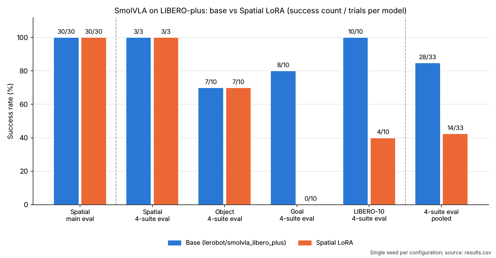

# SmolVLAのLoRA追加学習とLIBERO-plus評価

Physical AI講座の課題を出発点に、ロボットの視覚・言語・行動モデルSmolVLAに、Spatialタスクの成功軌道を使ってLoRAで追加学習しました。Spatialではベースと同じ30/30でした。4スイートの追加評価では、ベースの28/33に対しLoRA版は14/33でした。

**English summary.** I adapted a SmolVLA course experiment with Claude assistance, expanded the LIBERO-plus evaluation, and compared the same base policy with and without a Spatial LoRA adapter. Both reached 30/30 in the main Spatial evaluation. Across the four suites in the secondary evaluation, success fell from 28/33 to 14/33 after adaptation.

The numbers can be recomputed from `results.csv` with `python summarize.py` (standard library only); `plot_results.py` regenerates the chart and `pytest` checks the totals. Training and evaluation were run on a GPU and are not reproducible from this repository alone (see “再現に必要な環境（ローカル/GPU）” for what is recorded and what is still TODO).

## リポジトリの構成

| パス | 内容 |
| --- | --- |
| `README.md` | 実験の概要・設定・結果（本ファイル） |
| `results.csv` | 評価ごとのタスク数・試行数・成功数（ベース / LoRA） |
| `summarize.py` | `results.csv` から成功率・差・4スイート合計・等重み平均を再計算（標準ライブラリのみ） |
| `plot_results.py` | `results.csv` から下の図 `docs/success_by_suite.png` を生成（matplotlib） |
| `tests/` | `summarize.py` の集計値が `results.csv` と本READMEの数値に一致するかを確認するpytest |
| `requirements-dev.txt` | テストと図の生成に使うパッケージ（バージョン固定） |
| `.github/workflows/ci.yml` | push / Pull Requestで集計スクリプトとテストを実行するGitHub Actions |

学習・評価のNotebook、モデル重み（LoRAアダプタ）、評価JSONはこのリポジトリに含まれていません。

## 担当と変更点

配布Notebookを起点に、Claudeを活用して学習データの選定数、LoRA設定、評価の試行数、成功率の集計を変更しました。SmolVLA・LeRobot・LIBERO-plusは外部のモデル、ライブラリ、評価環境です。

| 項目 | 配布版の設定 | 改良版で実行した設定 |
| --- | --- | --- |
| Spatialの学習エピソード | 10タスク × 5、計50 | 10タスク × 10、計100。選定数をタスク数から検査 |
| LoRA rank / alpha | 16 / 16 | 64 / 64 |
| 学習ステップ / バッチサイズ | 3,000 / 1 | 10,000 / 8 |
| 学習率 / 減衰後の学習率 | 3e-4 / 3e-5 | 1e-3 / 1e-4。ウォームアップ100ステップ |
| 学習時の画像増強 | コマンドに指定なし | 有効 |
| 1回の推論で実行する行動ステップ数 | 50 | 評価する両モデルで10 |
| Spatial主評価 | 10タスク × 1試行 | 10タスク × 3試行。別枠の4スイート評価と集計を追加 |

実行記録の環境はGoogle Colab、NVIDIA A100 40 GB、LeRobot v0.6.0。学習はbf16設定、学習seedは42、評価seedは2026です。学習ログに10,000ステップの完了を確認しました。ベースモデルは `lerobot/smolvla_libero_plus`、学習データは `lerobot/libero_plus` です。

## 評価結果

ベースとLoRA版を同じタスクID、試行数、評価seed、行動ステップ数で評価しました。表の分母はモデルごとの試行数です。

| 評価 | ベース成功数 | LoRA成功数 | 成功率の差 |
| --- | ---: | ---: | ---: |
| Spatial主評価（10タスク × 3） | 30/30 | 30/30 | 0.0 pp |
| 4スイート評価のSpatial（タスクID 0・4・8、各1試行） | 3/3 | 3/3 | 0.0 pp |
| Object（10タスク × 1） | 7/10 | 7/10 | 0.0 pp |
| Goal（10タスク × 1） | 8/10 | 0/10 | −80.0 pp |
| LIBERO-10（10タスク × 1） | 10/10 | 4/10 | −60.0 pp |
| **4スイート合計（主評価を除く）** | **28/33（84.8%）** | **14/33（42.4%）** | **−42.4 pp** |



4スイートを等重みで平均しても87.5%から52.5%に下がりました。Spatialはベースがすでに全試行成功しており、この条件では改善を測れませんでした。GoalとLIBERO-10の低下が集計結果に表れています。複数の設定を同時に変えた単一seedの試行なので、低下の原因や他の条件での再現性は未検証です。

## 記録の照合と再集計

実行出力付きNotebookの学習・評価出力を確認し、評価アーカイブ内の10件のJSONからタスクIDと試行ごとの成否を再集計しました。主評価と4スイート評価の各比較CSV、集計CSV、Notebookの保存出力で成功数・試行数が一致しました。同時期に保存された統合モデルの設定値も、学習率・学習ステップ・行動ステップ数と整合しました。評価JSONにはモデル重みのハッシュがないため、評価結果と重みファイルの同一性は設定・出力の照合範囲です。

公開するのは上記の変更要約、実測した成功数と試行数のCSV、および公開用に書いた再集計スクリプトです。Python 3の標準ライブラリだけで、率・差・4スイートの試行数加重集計と等重み平均を再計算できます。

```sh
python summarize.py                # 標準ライブラリのみ。別のCSVを渡す場合は python summarize.py path/to/results.csv
```

出力例（`results.csv` の現在の内容での実行結果）:

```text
spatial_main/libero_spatial: 30/30 (100.0%) -> 30/30 (100.0%) (+0.0 pp)
cross_suite/libero_spatial: 3/3 (100.0%) -> 3/3 (100.0%) (+0.0 pp)
cross_suite/libero_object: 7/10 (70.0%) -> 7/10 (70.0%) (+0.0 pp)
cross_suite/libero_goal: 8/10 (80.0%) -> 0/10 (0.0%) (-80.0 pp)
cross_suite/libero_10: 10/10 (100.0%) -> 4/10 (40.0%) (-60.0 pp)
cross_suite/pooled: 28/33 (84.8%) -> 14/33 (42.4%) (-42.4 pp)
cross_suite/macro: 87.5% -> 52.5% (-35.0 pp)
```

`pooled` は4スイートの試行数加重（成功数の合計 ÷ 試行数の合計）、`macro` は4スイートの成功率の単純平均です。`spatial_main` は合計に含めません。

図の再生成とテストの実行（GPU不要）:

```sh
python -m pip install -r requirements-dev.txt
python plot_results.py             # docs/success_by_suite.png を上書き
python -m pytest -q
```

### results.csvの列

| 列 | 意味 |
| --- | --- |
| `evaluation` | `spatial_main`（Spatial主評価）または `cross_suite`（4スイート評価） |
| `suite` | LIBERO-plusのスイート名 |
| `task_count` / `episodes_per_task` | 評価したタスク数と1タスクあたりの試行数。積がモデルごとの試行数（分母） |
| `base_successes` / `lora_successes` | ベース / LoRA版の成功数 |

CSVから読み取れる評価条件は、Spatial主評価が10タスク × 3試行（各モデル30試行）、4スイート評価がSpatial 3タスク・Object / Goal / LIBERO-10 各10タスク、いずれも1試行（各モデル計33試行）です。

## 再現に必要な環境（ローカル/GPU）

このリポジトリの集計・図・テストはCPUのみで動きます。学習と評価そのものはこのリポジトリだけでは再実行できず、実行記録では下記のGPU環境で行っています。以下のうち「記録済み」は上の本文に記載済みの内容、「TODO」は作者が確認・追記する項目です。

**記録済み（本文の実行記録より）**

- 実行環境: Google Colab、NVIDIA A100 40 GB
- ライブラリ: LeRobot v0.6.0
- ベースモデル: `lerobot/smolvla_libero_plus`、学習データ: `lerobot/libero_plus`
- 学習: bf16設定、seed 42、10,000ステップ、バッチサイズ8、LoRA rank / alpha 64 / 64、学習率1e-3（減衰後1e-4）、ウォームアップ100ステップ、画像増強あり
- 評価: seed 2026、1回の推論で実行する行動ステップ数10（両モデル共通）

**TODO（作者が追記）**

- [ ] 学習・評価に使った実際のコマンドまたはNotebook（公開可能な範囲）
- [ ] Python・PyTorch・CUDAのバージョンと、LeRobot以外の主要パッケージのバージョン
- [ ] LIBERO-plusのリポジトリのコミット（またはバージョン）と、シミュレータ（MuJoCo等）・オフスクリーン描画の設定
- [ ] LoRAの対象モジュールやdropoutなど、上の表にない設定値
- [ ] 学習100エピソードの選定方法（どのタスク・どのエピソードIDを使ったか）
- [ ] 学習・評価それぞれの所要時間と、A100 40 GB以外で動くかどうか（必要VRAMの目安）
- [ ] LoRAアダプタの重みを公開するかどうか（公開する場合はその場所）

## 参考リンク

- [LeRobot](https://github.com/huggingface/lerobot)・[SmolVLAベースモデル](https://huggingface.co/lerobot/smolvla_libero_plus)
- [LIBERO-plus](https://github.com/sylvestf/LIBERO-plus)・[学習データの配布元](https://huggingface.co/datasets/lerobot/libero_plus)
- [Physical AI講座](https://weblab.t.u-tokyo.ac.jp/lecture/course-list/physical-ai/)
